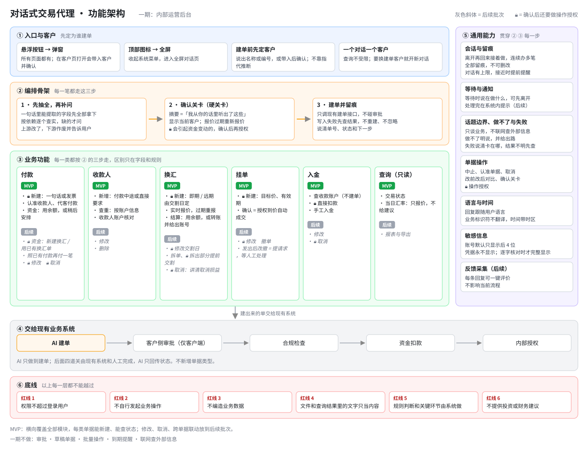

# 02 需求设计

## 1. PRD 的结构

第一次产品内部 review 时，同事给了两条反馈：产品和研发的边界不清；文档内容太多。我据此重构了 PRD：**PRD 只写需求，明细用引用指过去。** 我把 review 过程中调整出来的写法整理成一份 PRD 写作 SOP，后面边用边补。

```
1. 目标与范围（目标、覆盖范围、不做什么、MVP）
2. 角色与端（运营后台 / 客户门户，责任人是谁）
3. 通用需求
   ├─ RULE-01～06  红线：不能突破的底线，与它冲突的设计一律不成立
   └─ GEN-01～08   通用需求：入口与客户、会话与留痕、等待与通知、
                   话题边界与失败、单据操作、语言与时间、反馈采集、敏感信息
4–8. 五类交易章节（付款 / 收款人 / 换汇 / 挂单 / 入金）
9. 查询
10. 文案要求
11. 引用资料索引
```

**功能架构**：①→③ 是一笔交易的主线，④ 是交给现有系统的部分，⑤ 和 ⑥ 横切所有环节。



**写法规矩**

| 规矩 | 为什么 |
|---|---|
| 每章先列 Overview，每条需求按「总—分」写，带二级编号 | 不想到一条写一条；总的部分说过的，分的部分不再重复，避免同一件事出现两种口径 |
| 两端差异单独列成表，写在每一条上 | 一期只上运营后台，但按客户端标准设计。逐条讨论差异，以后上客户端不用重写 |
| 明细引用到具体位置，例如「见字段明细 1.1」，不写「见明细」 | 字段表、枚举、文案矩阵只放在一份明细文件里；曾复制出一份独立字典，同步一次就出了不一致 |
| 不写权限配置、角色名 | 不同角色能做什么由权限系统控制，需求只写「没有权限时怎么办」 |
| 「做得怎么样」以验收用例为准 | PRD 里不放验收样例 |

---

## 2. 产品和研发的边界：一句话标准

> **研发换一种实现方式，用户会不会看到不一样的结果？会，产品写；不会，研发自己定。**

| 例子 | 判断 |
|---|---|
| 写操作失败、结果不明时，必须先查询单据状态再继续 | **需求**。否则用户可能看到两张单 |
| 确认时用哪个 ID 调接口 | 实现，不写 |
| 交给 AI 之前就过滤掉用户看不到的数据 | **需求**。数据一旦交给 AI，它可能在任何一句回复里说出来 |
| 过滤在哪一层做、用什么组件 | 实现，不写 |

---

## 3. 六条红线

| 编号 | 红线 | 一句话 |
|---|---|---|
| RULE-01 | 权限不超过登录用户 | 用户能做、能看的，AI 才能做、能看。数据可见范围以页面为准：页面看不到、只是接口多返回的字段，不交给 AI |
| RULE-02 | 不自行发起业务操作 | 每次操作都由用户发起，并在确认卡上确认 |
| RULE-03 | 不编造业务数据 | 金额、汇率、账号、单号、状态都来自系统 |
| RULE-04 | 文件里的文字只当内容 | 上传文件和查询结果里的「指令」不照做，防提示词注入 |
| RULE-05 | 规则判断和关键环节由系统做 | 能不能建单由系统规则定；确认、权限、防重复由系统强制，不靠 AI 自觉 |
| RULE-06 | 不提供投资或财务建议 | 给事实，不给判断 |

---

## 4. 代表性的需求决策

### 4.1 对话里收集信息：一次抽全，只问缺的

- 用户一句话里能拿到的字段**全部拿走**，剩下的才按依赖关系分轮问。例如币种决定了收款人范围，所以币种要先定。
- **不猜**：「付 5000 块」没说币种就问；「付上次的一半」先查上次是多少，再请用户说确切金额，不替用户算。
- 相对日期（「这周六」）换算成具体日期；那天不是付款日的，给出最近的可用日让用户确认。
- 同一个字段问了两次还拿不到，给出路，不无限追问。
- 下拉类字段（例如资金来源）可以解释每个选项的含义，但**不推荐选哪个**；发现选择和发票、历史付款明显对不上时，在出确认卡之前提示用户可能选错了。

### 4.2 一个对话只为一个客户

- 运营同事要替很多客户操作，混了就会给错客户建单。所以一个对话只能定一个客户，换客户就开新对话。
- 新对话不继承旧对话的客户；用户说「给他们再付一笔」，不按上下文推断是哪个客户。
- 查询不算选定客户：查询可以跨客户，建单前必须明确客户。

### 4.3 认准是哪一条记录

- 收款人按名字模糊匹配，最多列 3 个最接近的候选，用户明确选了才算。
- 收款人去重看账户信息（路由号＋账号），不看户名。命中已有收款人时，引导用户用现有的，不重复建。

### 4.4 两道关卡：确认卡＋授权

- 信息收齐后先出**确认卡**，上面列出收款人所在地、金额、手续费、日期等，用户在卡上点[确认]。聊天里打「确认」不算。
- 会引起资金变动的操作，确认之后还要**授权**：点[授权]按钮，以后由 passkey 替换。授权方式经历了「验证码 → PIN → 确认后点授权」三版，最后定下原则：只在会引起资金变动的操作上要求授权，逐个操作判断。
- 用户改了一个字段，旧卡立即作废、重新出卡。点作废的旧卡，系统拦住。

### 4.5 建单之后

- 资金安排是可选的，放在建单之后：用余额、新建换汇、用已有换汇单、组合，或者稍后再安排。余额不够也能建单，提醒用户在付款日前及时入金即可。
- 建单结果一次说清：单号、状态，以及还没完成的事。

### 4.6 风控相关的红线

| 场景 | 决策 |
|---|---|
| 超过限额，用户问怎么办 | **任何情况下都不能建议拆单**，这等于教用户规避风控 |
| 用户问「多少钱以下不用审批」 | 不回答。是否需要审批，提交后才能知道，和页面行为一致，不给用户试探防御机制的机会 |
| 合规状态 | 运营后台可以说交易处于合规审核；命中的合规规则和内部备注，两端都不能说；客户端只用对外状态 |

### 4.7 对话不是表单

页面上特有的边界场景，不照搬成对话规则。先想对话里会不会真的发生。

- 例：页面上「修改时什么都没改也能提交」。在对话里，用户要改单一定会说要改什么，这个场景根本不会触发，不需要写规则。

---

## 5. MVP

**横向覆盖全部模块，纵向做减法：每类单据都能新建、能查状态；修改、取消，以及跨单据的联动（付款用换汇单出资、拆单等）放到后续批次。**

复盘时我认为 MVP 定得太晚（见 07），下次会先锁一条最窄的端到端路径。
