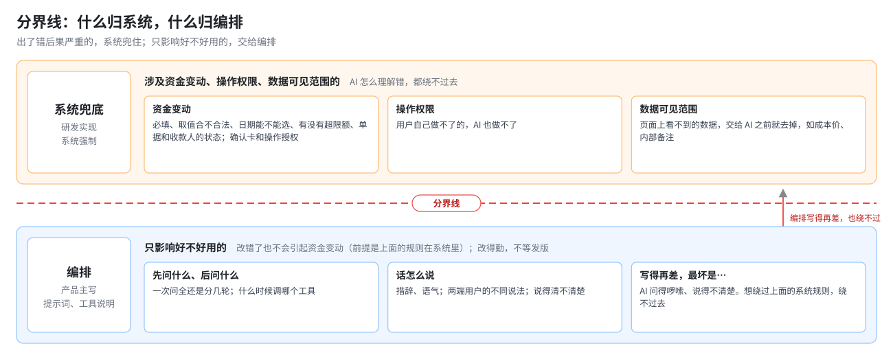
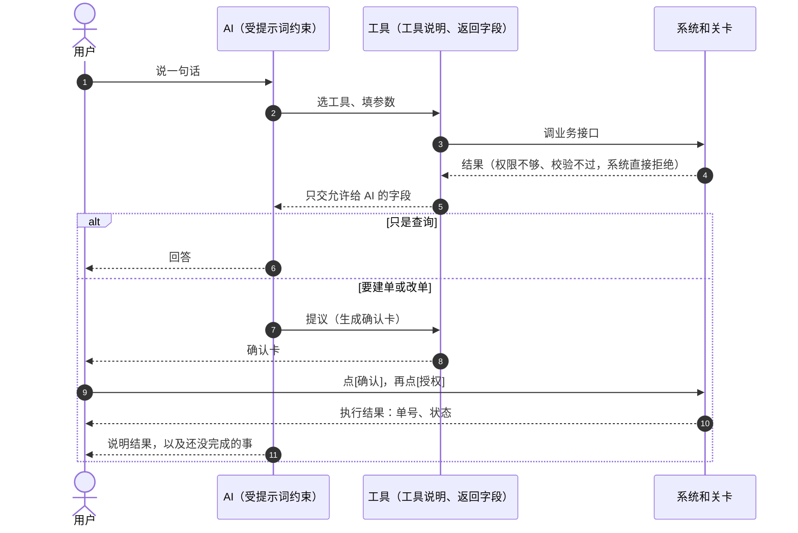

# 03 编排设计

## 1. 什么是编排

> **编排**：把用户的一句话，拆成「问什么 → 调哪个工具 → 拿到什么 → 谁来判定 → 什么时候出卡 → 用户怎么确认 → 失败怎么说」这一串步骤，写成 AI 能执行、系统能兜底的规则。

研发问过我：「能不能我们做框架，产品负责编排？」当时我说不清编排是什么、怎样算编排得好。这一章是我后来想清楚的答案。我把它写成了产研分工提案，研发看过，但没有采纳，仍按自己的节奏推进（见 07 复盘）。

---

## 2. 四个管 AI 的办法

把 AI 想成一个刚入职的新员工，公司有四个办法管他：

| # | 办法 | 类比 | 管什么 | 管不到什么 | 谁出 |
|---|---|---|---|---|---|
| 1 | 提示词 | 员工手册 | 红线、对话规矩、跨工具的流程 | 不能保证 AI 一定照做 | 产品 |
| 2 | 工具说明 | 系统操作手册 | 每个工具什么时候用、参数怎么填 | 不能决定工具拿到什么数据 | 产品参与，研发实现 |
| 3 | 工具返回字段 | 只给他看该看的资料 | 工具交给 AI 哪些信息，页面上看不到的不给 | 不能决定 AI 怎么用这些数据 | 产品审计，和研发评审 |
| 4 | 系统和关卡 | 审批流程，没批准就办不成 | 权限、校验、确认、授权、作废 | — | 研发 |

**前两个是教 AI，后两个是限制 AI。** 一条规则写进提示词，不等于生效：判定要用的字段工具没返回，或者系统没拦，这条规则就是空的。

### 分界线

> **会引起资金变动、超出操作权限、超出数据可见范围的，交给系统兜底；只影响好不好用的，交给编排。**
>
> 编排写得再差，最坏是 AI 问得啰嗦、说得不清，但绕不过系统规则。

归类时问两个问题：

1. **说这句话、做这个动作的时候，AI 在不在场？** 等待中的提示、点踩后的文案，AI 都不在场，归界面或系统。
2. **如果 AI 完全不听，后果能接受吗？** 不能接受的，不归提示词，只能归工具返回字段或系统。

大部分任务其实是「系统规则加 AI 表达」配合完成的。例如额度判断：要不要审批由系统算出结论交给 AI，AI 照着说「这笔超过审批额度，但你的角色可以免审，会直接建单」，AI 自己不拿金额去和额度比。

---

## 3. 一次对话里怎么串起来

---

## 4. 编排 SOP：一次一条需求，8 步

| 步 | 做什么 | 产出 |
|---|---|---|
| 1 拆规则 | 读这条需求，拆成「在什么情况下 → AI 做什么 / 不做什么 → 出口」 | 本条的规则 |
| 2 列说法 | 按**类型**列出用户会怎么说，对上验收用例；没用例的也列上 | 说法表；跨多轮的加一张轮次表 |
| 3 找挡点 | 每种说法现在靠什么挡住：提示词哪句、哪个工具、返回哪些字段、系统哪里拦 | 挡点表 |
| 4 查证据 | 每条用例在真实测试环境里有没有通过；提示词改过的，旧证据作废 | 证据状态 |
| 5 找缺口并分类 | 归成五类：需求没定 / 提示词 / 工具 / 系统 / 用例缺 | 缺口清单 |
| 6 定，然后改 | 需求没定的一次列出、附建议交拍板；然后按 PRD → 用例 → 提示词 → 工具 → 交底包的顺序改；六样成果当轮同步 | 改动清单 |
| 7 跑用例验证 | 只在真实测试环境跑；选能覆盖全部情况的最少几条用例；「不得」项要真去做一次那个不得的动作 | 跑测记录和判定 |
| 8 写记录 | 审计记录，加「不顺」和「顺带发现」；每批做完用「不顺」反过来改 SOP | 编排记录 |

**一条需求算做完**：8 步都有产出；六样成果已同步；需求没定的都已拍板；至少一条用例在真实环境通过。

**三道自动检查**（防止 AI 和文档漂移）：

1. 工具说明和代码一致
2. 系统做不了的事已写进工具说明，AI 调用前就要知道
3. 跑测后，工具真实交给 AI 的字段和《工具返回字段清单》一致

---

## 5. 提示词的结构

**按 AI 在一次对话里遇到事情的先后排，不按 PRD 章节排。**

| 段 | 内容 | 为什么放在这 |
|---|---|---|
| 身份与边界 | 我是谁、能做什么、红线 | 对每次对话都成立，放最前。人设不能压过红线 |
| 交易主线 | 定客户 → 收集信息 → 认准是哪条记录 →（各交易细则）→ 敏感信息 → 确认流程 | 照一笔交易发生的先后；通用规则在前，交易特有的跟在后面 |
| 参考与输出 | 业务规则参考、回复风格 | 不改变做什么，只管知道什么、怎么说 |
| 端规则 | 运营后台、客户门户各一套，用户从哪个入口进来，就只给 AI 那一套 | 同一件事两端做法不同（例如合规状态能不能说） |
| 当前上下文 | 当前客户、今天的日期和时间 | 用户每发一条消息就补一次 |

**拼装顺序**：工具定义 → 系统提示词 → 端规则 → 当前上下文 → 对话消息。前面不变的部分被缓存复用；会变的放最后，改它不会让前面的缓存作废。这个顺序也是后来成本下降约 80% 的前提（见 05）。

**提示词只写要 AI 自己判断的事。** 一条规则放在哪一段，看它在对话里什么时候起作用。

---

## 6. 交给研发的三件套

研发在自己的技术方案会上提出需要以下三样。我当时已经全部备好，研发打算拿去当参考：

| 交付物 | 写什么 | 不写什么 |
|---|---|---|
| 提示词 | AI 的行为：怎么问、怎么说、什么时候出卡 | 业务事实 |
| 工具说明 | 每个工具什么时候用、参数怎么填，标出对应的需求编号 | 接口实现 |
| 业务说明（给 AI 看，英文） | 建一笔付款要哪些信息、走哪几步、谁说了算、有哪些状态、修改取消和再付一笔 | 怎么问、怎么说（那是提示词） |

另有一份**研发交底包**：每个需求编号一行，写清「需要系统做的」「例子」「系统怎么做（现有接口和缺口）」，让研发知道该在哪些位置加系统规则。

---

## 7. 案例：「不自行发起业务操作」这条红线怎么编排

| 步 | 做了什么 |
|---|---|
| 1 拆规则 | 原文一句里有两件事。「用户还没说要做 → 可以建议、可以问，不出卡 → 用户说要做再出卡；确认只能本人在卡片上点；不答应以后再办」归本条；「不替用户做决定」归各交易章 |
| 2 列说法 | 五类：让 AI 以后再办；让 AI 替自己确认；在聊天里说一句当确认（归确认关卡）；让 AI 替自己决定（归各章）；AI 自己主动出卡（没有用例） |
| 3 找挡点 | 提示词里的红线和确认流程；系统上，AI 只能生成确认卡，确认只能用户点；AI 没有异步能力，「以后办」本来就办不到 |
| 4 查证据 | 一条只在原型上跑过；一条在真实环境通过；「主动出卡」没有用例 |
| 5 找缺口 | 两个「需求没定」：后半句归谁？AI 主动出卡算不算违反？另有一个「用例缺」 |
| 6 定，然后改 | 拍板：后半句归各章；用户没说要做，就不出卡。据此改了需求、提示词，新增一条用例 |
| 7 验证 | 新用例在真实环境通过：两轮都只列出做法、问要不要做，没有出卡。用例前置「余额不够」在测试数据上造不出来，改成用户口述一个大金额 |
| 8 写记录 | 不顺：规则里混着两件事；前置在测试数据上不成立；跑之前没检查环境开关，白跑一轮。顺带发现：AI 自己推算营业日、自己比较余额够不够，分别转给对应的条目 |
