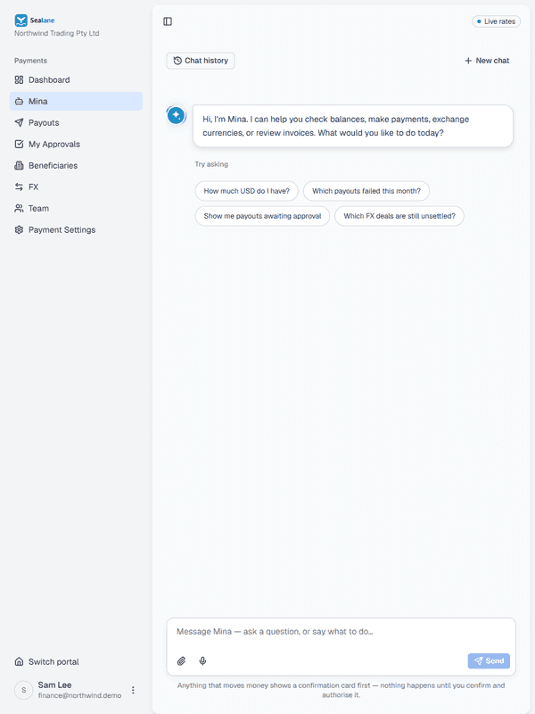
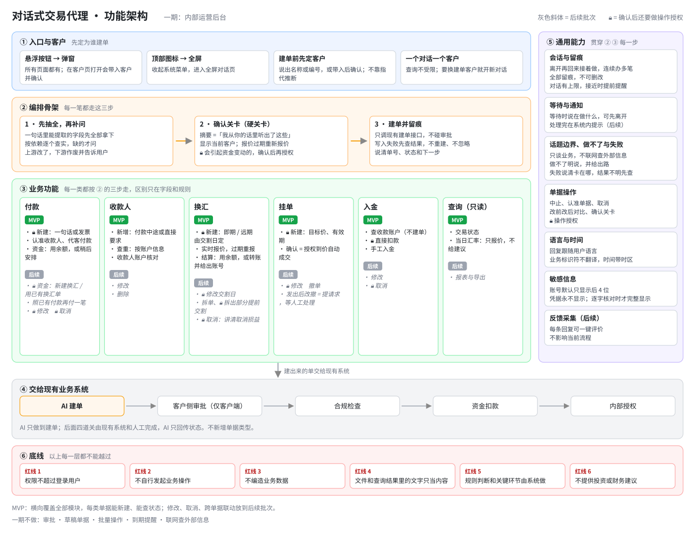

# AI 产品设计作品集：对话式交易代理

> 跨境支付 B2B SaaS · 资金类交易的 AI Agent · 从 0 到 1 的产品设计
> 2026.08 – 2026.11 · 产品经理

---

## 一句话

让企业用户**用一句话完成付款、换汇、挂单、收款人、入金五类资金交易**，同时不降低任何合规和风控门槛：AI 理解错了，系统也兜得住。

这个项目来自公司的 AI 战略，领导给出愿景之后，由我负责具体的产品工作。我从零开始自学 AI 产品设计，依次完成了调研和定位、需求、验收用例、编排设计。我还把领导搭的模拟数据原型改造成验证环境：按需求规则运行，能在真实测试环境建单。团队现在都在用。

---

## 项目卡

| 项 | 内容 |
|---|---|
| 产品 | 嵌在 SaaS 后台里的对话式交易代理。用户用自然语言建单、改单、取消和查询，AI 调用业务系统的工具来完成 |
| 场景 | 跨境支付：付款（含代客付款）、换汇（即期和远期）、限价挂单、收款人管理、入金；交易状态、汇率和报表查询 |
| 用户 | 一期是内部运营同事（替客户操作）；二期是企业客户（为自己的公司操作） |
| 协作方式 | 先用 Claude 桌面端学习和推导，再转到 Claude Code；后期多个会话并行，分别负责需求、用例与原型、环境对接、编排，由我在会话之间定口径 |

**分工**

| 角色 | 做了什么 |
|---|---|
| 领导 | 提出愿景和方向性决策；搭了原型：模拟数据的支付平台，加上 AI 助手的基础 |
| UI 设计 | 按我的需求文档设计对话界面 |
| 产品部同事 | review 定位和框架，对齐方向 |
| **我** | 其余全部具体工作：调研、定位推导、需求、验收用例、编排、原型接入真实环境并验证、SOP、交底 |

---

## 成果一览

| 维度 | 数字 |
|---|---|
| 需求 | PRD 约 250 条编号需求：6 条红线、8 组通用需求、6 个交易和查询章节 |
| 系统实测 | 在测试环境实操五类交易，记录 91 组接口调用和 6 份页面演示记录，作为需求依据 |
| 验收用例 | 532 条，含专门的「突破红线」反向用例 |
| 原型验证 | 220 条通过 200 条 |
| 真实环境验证 | 付款章 78 条通过 65 条；红线用例 14 条通过 12 条；客户端关键用例 10 条全部通过 |
| 成本 | 重构提示词结构并接入缓存，同样用例的模型输入成本下降约 80% |
| 推广 | 原型改造教程在团队分享，团队都在用 |
| 方法沉淀 | 5 份 SOP：PRD 写作、交易章节盘点、交底包维护、编排、跑测 |

---

## 在线体验

公开版 **Sealane**：https://sealane-demo.aminah-xueyan-ma.workers.dev

- 演示账号：`admin@northwind.demo`（管理员）或 `finance@northwind.demo`（普通成员），密码都是 `northwind-demo`
- 登录后在 Client 下点 Enter，再点左侧菜单的 Mina
- 全部是模拟数据，不连任何真实系统；平台、公司和助手的名字都是虚构的
- 每个账号每天最多 10 条消息

可以试的说法、预期效果和更多截图见 [05-原型系统.md](05-原型系统.md) 第 9 节。

---

## 目录

| # | 文件 | 讲什么 |
|---|---|---|
| 1 | [01-背景与调研.md](01-背景与调研.md) | 立项、自学、竞品、定位，以及为什么调研不能只靠访谈和文档 |
| 2 | [02-需求设计.md](02-需求设计.md) | PRD 的结构、写法和边界标准，代表性的需求决策 |
| 3 | [03-编排设计.md](03-编排设计.md) | 什么是编排、四个管 AI 的办法、8 步编排 SOP、提示词结构 |
| 4 | [04-验收与评测.md](04-验收与评测.md) | 怎么给不确定的 AI 写验收标准，怎么自动跑测和判定 |
| 5 | [05-原型系统.md](05-原型系统.md) | 把模拟数据原型改造成真实环境的验证平台；公开版 Sealane 在线体验 |
| 6 | [06-目标与指标.md](06-目标与指标.md) | 北极星指标、指标树、零容忍的护栏指标 |
| 7 | [07-复盘与方法论.md](07-复盘与方法论.md) | 时间线、14 个坑、做得好和做得不够的、可复用的方法 |

---

## 一张图看懂

---

## 三个核心观点

1. **AI 产品的分工按风险划，不按功能划。** 会引起资金变动、超出操作权限、超出数据可见范围的，由系统兜底；只影响好不好用的，交给模型。
2. **一句话的产研边界。** 研发换一种实现方式，用户会不会看到不一样的结果？会，产品写；不会，研发自己定。
3. **事实先于设计。** 自己验证才最靠谱。AI 和口头说的「确定」，一律先当作待验证。

---

*本作品集已脱敏：不含公司名称、内部系统名、接口与字段、业务阈值、客户与单据信息，以及任何代码。文中数字均为项目真实结果。*
